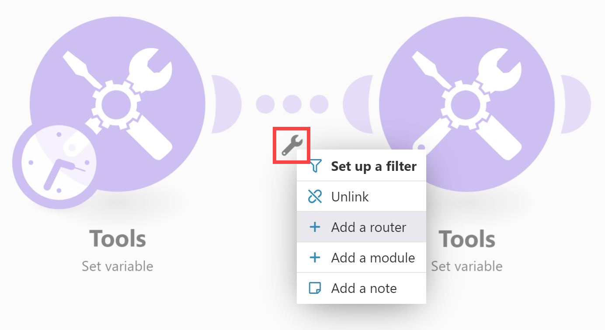

# Add a Router module and configure routes

The Router module allows you to branch your scenario into several routes, and process the data within each route differently. When a Router module receives a bundle, it forwards it to each connected route in the order the routes were attached to the Router module.

Routes are processed sequentially, not in parallel. A bundle is not sent to the next route until it has been completely processed by the previous route.

>[!NOTE]
>
>Workfront Fusion is transitioning the scenario editor to a new experience. During this transition, both the classic and new experiences are available, and you can switch between them at any time. We recommend using the new experience. For more information, see [New and classic experiences](/help/workfront-fusion/get-started-with-fusion/navigate-fusion/scenario-editor.md#new-and-classic-experiences) in the article Scenario editor.

## Access requirements

+++ Expand to view access requirements for the functionality in this article.

<table style="table-layout:auto">
 <col> 
 <col> 
 <tbody> 
  <tr> 
   <td role="rowheader">Adobe Workfront package</td> 
   <td> 
Any Adobe Workfront Workflow package and any Adobe Workfront Automation and Integration package

Workfront Ultimate

Workfront Prime and Select packages, with an additional purchase of Workfront Fusion.
 </td> 
  </tr> 
  <tr data-mc-conditions=""> 
   <td role="rowheader">Adobe Workfront licenses</td> 
   <td> 
Standard

Work or higher
 </td> 
  </tr> 
  <tr> 
   <td role="rowheader">Product</td> 
   <td>
   
If your organization has a Select or Prime Workfront package that does not include Workfront Automation and Integration, your organization must purchase Adobe Workfront Fusion.</li></ul>
   </td> 
  </tr>
 </tbody> 
</table>

For more detail about the information in this table, see [Access requirements in documentation](/help/workfront-fusion/references/licenses-and-roles/access-level-requirements-in-documentation.md).

+++

## Add a Router module to a scenario

You must add a Router module before configuring routes.

* [Add a Router module to a scenario in the new experience (Recommended)](#add-a-router-module-to-a-scenario-in-the-new-experience-recommended)
* [Add a Router module to a scenario in the classic experience](#add-a-router-module-to-a-scenario-in-the-classic-experience)

### Add a Router module to a scenario in the new experience (Recommended)

1. Click the **[!UICONTROL Scenarios]** tab in the left panel.
1. Select the scenario where you want to add a router.
1. Click anywhere on the scenario to enter the Scenario editor.
1. Hover over the right edge of the module after which you want to add the router, then click **[!UICONTROL Add another module]** when it appears. In the list that opens, select the **[!UICONTROL Built-in]** category, then select **[!UICONTROL Flow Control]** > **[!UICONTROL Router]**.

    Or

   To insert the Router module between two modules, right-click the path connecting the two modules, then select **[!UICONTROL Add a router]**.

   

1. Add the first route to the router by hovering over the right edge of the router and adding a module, similar to adding any module. 
1. To add another route, click the router module. A route appears. Add modules to this route as desired.

   You can add as many routes as you want.

1. To verify the order of the routes, check the label for each route. Route 1 executes first, then Route 2, and so on.

   Or
   
   Click the **Auto-align** icon  in the Controls area.

   The routes are arranged in the order they execute. The top route executes first.

1. (Optional) To change route order, right-click the Router module and select **Order routes**. Drag and drop the routes in the order you want them to execute in. Routes are marked by the first module that follows the router (the first module of the route).
1. (Optional) To disable a route, right-click the path that leads from the router to that route, and select **Disable route**.

   Disabled routes display gray dots leading from the router to the first module on the route, and show a the disabled route icon  on the label.

1. (Optional and conditional) To enable a disabled route, click the disabled route icon  on the route's label.
1. Continue to [Add a filter to a route in the new experience](#add-a-filter-to-a-route-in-the-new-experience-recommended).

### Add a Router module to a scenario in the classic experience

1. Click the **[!UICONTROL Scenarios]** tab in the left panel.
1. Select the scenario where you want to add a router.
1. Click anywhere on the scenario to enter the Scenario editor.
1. In the scenario editor, click on the right handle of the module after which you want to add the router, then select **[!UICONTROL Flow Control]** > **Router** in the list of modules that displays.

   

    Or
 
   To insert the Router module between two modules, click on the wrench icon below the route connecting the two modules and select **[!UICONTROL Add a router]** from the menu.

   
1. Add the first route to the router by clicking on the right handle of the router and adding a module, similar to adding any module. 
1. To add another route, click the router module. A route appears. Add modules to this route as desired.

   You can add as many routes as you want.

1. To verify the order of the routes, check the label for each route. Route 1 executes first, then Route 2, and so on.

   Or
   
   Click the Auto-align icon .

   The routes are arranged in the order they execute. The top route executes first.

1. (Optional) To change route order, right click on the Router module and select **Order routes** Drag and drop the routes in the order you want them to execute in. Routes are marked by the first module that follows the router (the first module of the route).

   

1. (Optional) To disable a route, right click on the dots that lead from the router to that route, and select **Disable route**.

   Disabled routes display gray dots leading from the router to the first module on the route, and show a the disabled route icon  on the label.

1. (Optional and conditional) To enable a disabled route, click the disabled route icon  on the route's label.
1. Continue to [Add a filter to a route in the classic experience](#add-a-filter-to-a-route-in-the-classic-experience).

## Add a filter to a route

You can put a filter on a route after the Router module to filter bundles. Only bundles that pass through the filter will be handled by the modules on the route.

If data passes the filter of more than one route, the data is handled by both routes. The top route handles the data first.

Routers with filters display the filter icon  on the route label.

* [Add a filter to a route in the new experience (Recommended)](#add-a-filter-to-a-route-in-the-new-experience-recommended)
* [Add a filter to a route in the classic experience](#add-a-filter-to-a-route-in-the-classic-experience)

### Add a filter to a route in the new experience (Recommended)

1. Click the **[!UICONTROL Scenarios]** tab in the left panel.
1. Select the scenario where you want to add a filter.
1. Click anywhere on the scenario to enter the Scenario editor.
1. Left-click the path where you want to set a filter. This is the path between the router module and the first module of the route.

   The **[!UICONTROL Set up a filter]** window opens directly.

1. In the label field of the panel that displays, add a label. This label displays in the scenario. 
1. Configure filter conditions.

   For more information, see [Add a filter to a scenario](/help/workfront-fusion/create-scenarios/add-modules/add-a-filter-to-a-scenario.md).

   

1. Click **[!UICONTROL OK]** to save the filter setup.
1. (Conditional) If the filter name is too long to fit in the label, hover over the label to display the entire name.

1. Continue to [Configure a fallback route in the new experience](#configure-a-fallback-route-in-the-new-experience-recommended).

### Add a filter to a route in the classic experience

1. Click the **[!UICONTROL Scenarios]** tab in the left panel.
1. Select the scenario where you want to add a filter.
1. Click anywhere on the scenario to enter the Scenario editor.
1. Click the wrench icon  on the path where you want to set a filter. This is the path between the router module and the first module of the route.
1. Select **Set up a filter.**
1. In the label field of the panel that displays, add a label. This label displays in the scenario. 
1. Configure filter conditions.

   For more information, see [Add a filter to a scenario](/help/workfront-fusion/create-scenarios/add-modules/add-a-filter-to-a-scenario.md).

1. Click **[!UICONTROL OK]** to save the filter setup.
1. (Conditional) If the filter name is too long to fit in the label, hover over the label to display the entire name.

1. Continue to [Configure a fallback route in the classic experience](#configure-a-fallback-route-in-the-classic-experience).

## Configure a fallback route

The fallback route is the route that executes on any bundles that do not pass any filter to another route.

Fallback routes display "Fallback" on the label.

You can enable a fallback route in the filter panel.

* [Configure a fallback route in the new experience (Recommended)](#configure-a-fallback-route-in-the-new-experience-recommended)
* [Configure a fallback route in the classic experience](#configure-a-fallback-route-in-the-classic-experience)

### Configure a fallback route in the new experience (Recommended)

1. Click the **[!UICONTROL Scenarios]** tab in the left panel.
1. Select the scenario where you want to add a fallback route.
1. Click anywhere on the scenario to enter the Scenario editor.
1. Left-click the path where you want to set a filter. This is the path between the router module and the first module of the route.

   The **[!UICONTROL Set up a filter]** window opens directly.

1. In the label field of the panel that displays, add a label. This label displays in the scenario.
1. Enable the fallback route checkbox.

   

1. Click **[!UICONTROL OK]** to save the filter setup.

The fallback route's label displays **Fallback** in green.

### Configure a fallback route in the classic experience

1. Click the **[!UICONTROL Scenarios]** tab in the left panel.
1. Select the scenario where you want to add a fallback route.
1. Click anywhere on the scenario to enter the Scenario editor.
1. Click the wrench icon  on the path where you want to set a filter. This is the path between the router module and the first module of the route.
1. Select **Set up a filter.**
1. In the label field of the panel that displays, add a label. This label displays in the scenario.
1. Enable the fallback route checkbox.

   

1. Click **[!UICONTROL OK]** to save the filter setup.

The Fallback route is marked with a different arrow in the Router module:

## Example: `if/else` use case

>[!BEGINSHADEBOX]

A typical use case of the fallback route is to continue the flow with one route if the condition is met and with another route if it is not. as in the following steps:

In this example, the first route is configured with a filter. This represents the `if` component. 

   

The second route is configured as a fallback route. This represents the `else` component.

   

>[!ENDSHADEBOX]
