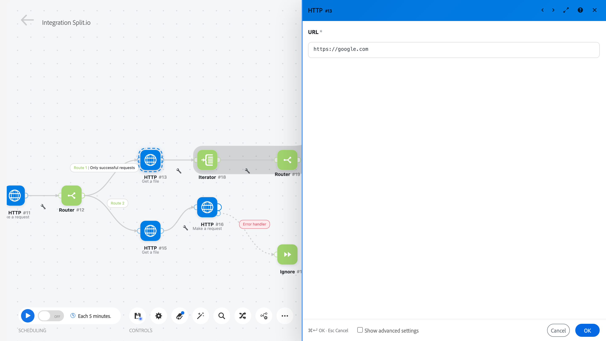
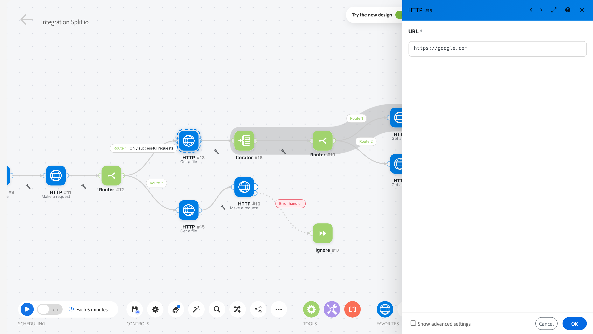
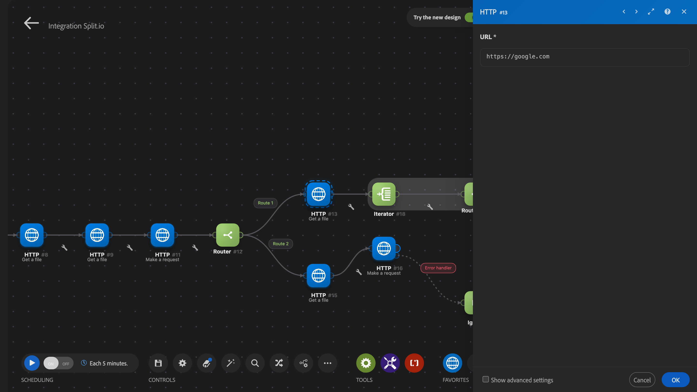
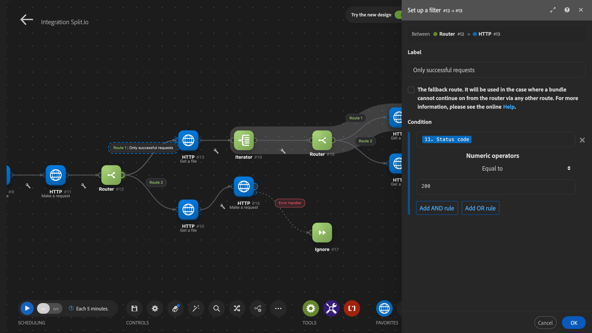
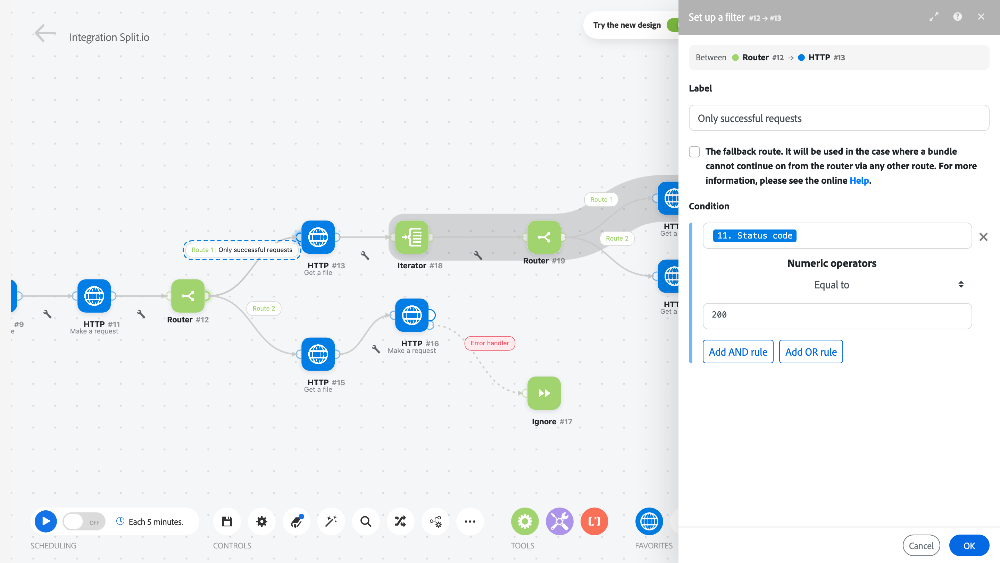
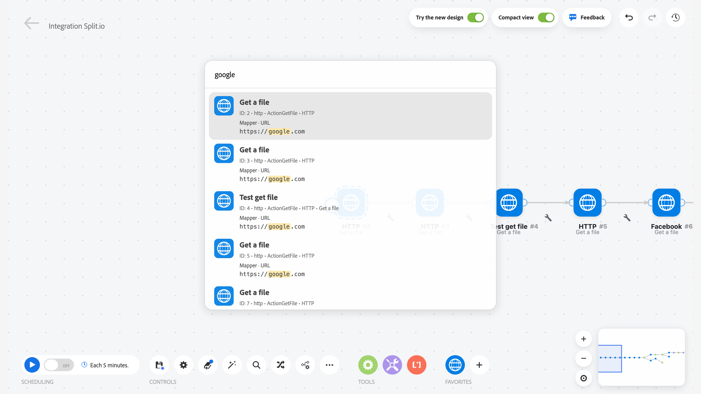
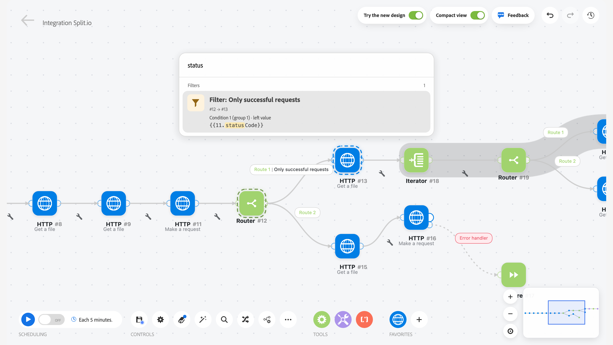
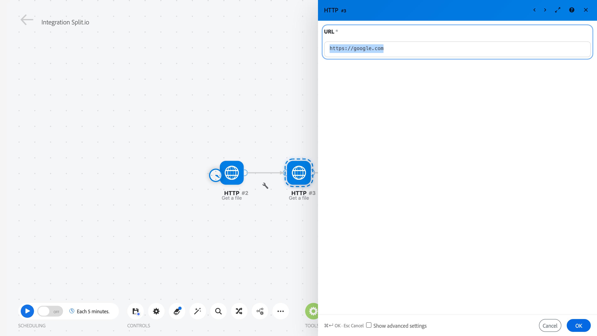
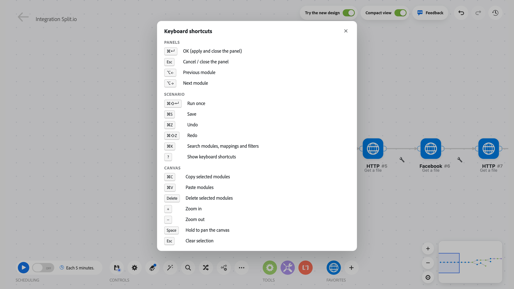
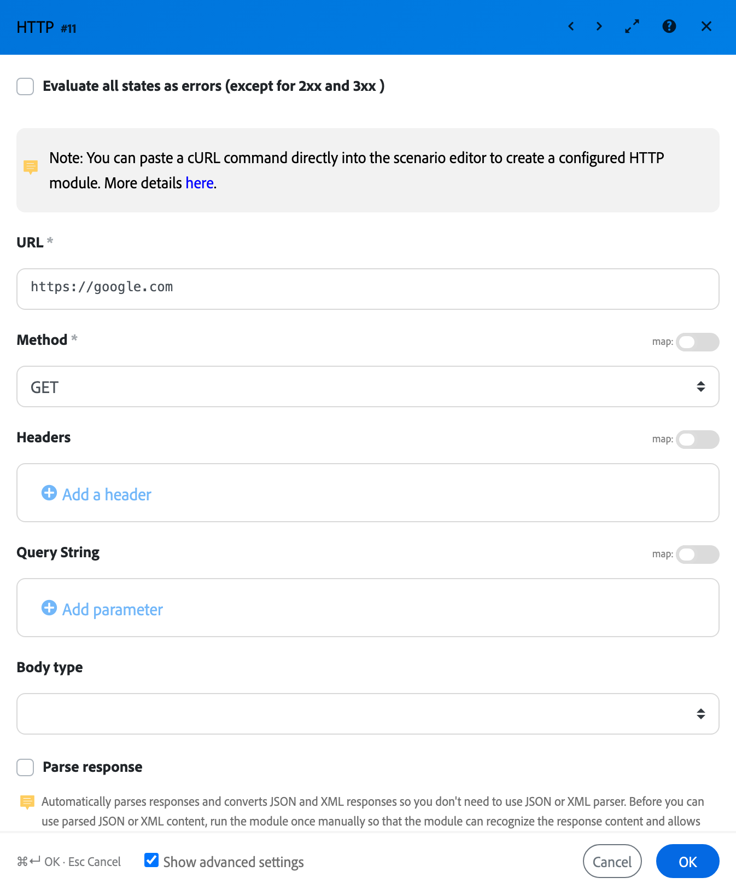

# Workfront Fusion release activity: Week of November 2, 2026

This page describes all enhancements made in Adobe Workfront Fusion the week of November 2, 2026.

For a list of all recent changes, see [Adobe Workfront Fusion release activity](/help/workfront-fusion/fusion-product-releases/fusion-release-activity.md).

For a list of recent bug fixes in Workfront Fusion, see the [Workfront Maintenance Updates](https://experienceleague.adobe.com/en/docs/workfront-known-issues/releases/current-updates) page and check for any updates labeled Workfront Fusion Maintenance Update.

## Updates to the new scenario designer: faster editing on wide screens, search across mappings, and clearer highlights

>[!NOTE]
>
>These changes apply to the new scenario designer.
>To use the new scenario designer, toggle, the **Try the new design** switch in the scenario editor. 
>The classic scenario designer is unchanged.

These updates reduce mouse travel when you edit scenarios, especially on large monitors, and make it easier to see which module or filter you are editing and to find where a value is used.

### Resize the side panel

Module settings, filters, Debug, and other panels open in a column on the right side of the screen. You can now make that column wider or narrower.

* **Drag the left edge** of the panel to resize it.
* **Double-click the edge** to return to the default width.
* Your width is remembered, also when you sign in from another browser. On a smaller screen, the panel automatically fits the window.
* While a panel is maximized, its width can't be changed.

---

### See which module or filter you are editing

* When you open a module, the canvas **no longer moves**. Instead, the module gets a **moving dashed outline**, the same outline you see when you select modules with Shift + drag.
* When you open a filter, its **label on the connection** gets the same outline.
* The outline color matches the module's color and is adjusted automatically when needed, so it stays visible in both light and dark mode.

_The same in dark mode:_

---

### Filter panel shows where the filter is

The filter panel now shows which two modules the filter sits between:

* next to the panel title, the module IDs, for example **#12 → #13**;
* above the filter settings, a line such as **Between ● Router #12 → ● HTTP #13**, with each module's color and name. Hover a module name to see its action.

---

### Search mappings, settings, and filters

The search (**⌘ K** on Mac, **Ctrl + K** on Windows) is now called **Search** and finds much more than module names:

* It searches module names and IDs, every **mapped value**, every **module setting**, and every **filter condition**.
* Each result shows **where the match was found**, for example _Mapper · Approval ID_, with the matching text highlighted. Filters are listed in their own section.
* Paste a reference such as `{{1.name}}` to find exactly the places that use it (not `{{21.name}}` or `{{1.names}}`).
* Opening a result opens the module or filter and **briefly highlights the matching field**, scrolled into view.
* When you move through filter results with the arrow keys, the canvas shows the filter and the two modules it connects.

---

### Keyboard shortcuts

Common panel actions now have keyboard shortcuts, so you don't need to move the mouse to the panel buttons.

| Shortcut (Mac / Windows) | What it does |
| --- | --- |
| **⌘ Enter** / **Ctrl + Enter** | Confirms the open panel (same as **OK**). Works while you type. With no panel open, runs the scenario once. |
| **Esc** | Closes the open panel without saving. If the mapping panel is open, closes only that panel. |
| **⌥ ←** / **⌥ →** (Mac), **Alt + ←** / **Alt + →** (Windows) | Confirms the panel and opens the previous or next module. Also available as **‹ ›** buttons in the panel header. Works when the cursor is not in a text field. |
| **⌘ Shift + Enter** / **Ctrl + Shift + Enter** | Confirms the open panel and runs the scenario once. Nothing runs if the panel has errors. |
| **⌘ K** / **Ctrl + K** | Opens Search. |
| **?** | Shows the list of all scenario designer shortcuts. Also available from the **…** menu → **Keyboard shortcuts**. |

* Wide panels show a reminder of the confirm and cancel shortcuts at the bottom.
* The **Run once** and **Save** buttons show their shortcuts in their tooltips.
* When you move to the next or previous module and it is hidden behind the panel or off-screen, the canvas moves just enough to show it.

## Explain errors with AI

When a scenario run fails, you can now get a short, plain-language description of what went wrong and how to fix it. The explanation appears next to the original error, so you can read both together.

You can explain errors in the following areas:

* **Scenario designer:** In the module's error details.
* **Scenario execution history:** In the run details of a failed run. If several modules failed, you can explain each error on its own.
* **Insights page:** In the Failed executions table.

This feature is available only in the new scenario designer, and your organization must have an AI license.

For more information, see [Explain a scenario error with AI](/help/workfront-fusion/manage-scenarios/explain-errors-with-ai.md).
