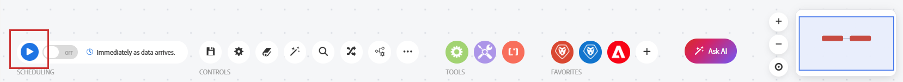
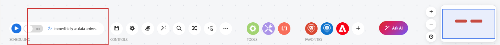

# The scenario editor

The scenario editor allows you to create and edit scenarios in a visual interface.

The new scenario editor experience:

The classic scenario editor experience

## Access requirements

+++ Expand to view access requirements for the functionality in this article.

<table style="table-layout:auto">
 <col> 
 <col> 
 <tbody> 
  <tr> 
   <td role="rowheader">Adobe Workfront package</td> 
   <td> 
Any Adobe Workfront Workflow package and any Adobe Workfront Automation and Integration package

Workfront Ultimate

Workfront Prime and Select packages, with an additional purchase of Workfront Fusion.
 </td> 
  </tr> 
  <tr data-mc-conditions=""> 
   <td role="rowheader">Adobe Workfront licenses</td> 
   <td> 
Standard

Work or higher
 </td> 
  </tr> 
  <tr> 
   <td role="rowheader">Product</td> 
   <td>
   
If your organization has a Select or Prime Workfront package that does not include Workfront Automation and Integration, your organization must purchase Adobe Workfront Fusion.</li></ul>
   </td> 
  </tr>
 </tbody> 
</table>

For more detail about the information in this table, see [Access requirements in documentation](/help/workfront-fusion/references/licenses-and-roles/access-level-requirements-in-documentation.md).

+++

## New and classic experiences

Workfront Fusion is transitioning the scenario editor to a new experience. During this transition, both the classic and new experiences are available, and you can switch between them at any time.

The new experience includes:

* A redesigned canvas, with card-style modules, a minimap, and zoom controls.
* New scenario editor controls, including Find and replace, Snippets, and Undo/Redo.
* An Ask AI button.
* An updated connector picker with category navigation and the ability to mark favorites inline.

To switch between the classic and new experiences:

1. In the scenario editor, locate the **[!UICONTROL Try the new design]** toggle in the upper-right corner.
1. Click the toggle to switch to the new experience. Click it again to return to the classic experience.

## Use the scenario editor in the new experience

### Open the scenario editor and add a module:

1. Click **[!UICONTROL Scenarios]**  in the left panel.
1. Click the placeholder module to open the list of apps and services.
1. Select the app or service that you want to start with:

   * Browse by category using the panel on the left ([!UICONTROL Favorites], [!UICONTROL All apps], [!UICONTROL Adobe Workfront], [!UICONTROL Adobe Firefly Services], [!UICONTROL Adobe Creative & Content], [!UICONTROL Adobe Cloud Services], [!UICONTROL Generative AI], or [!UICONTROL Built-in]).
   * Enter a term in the search box to filter the list.
   * To add a connector to your favorites, hover over the connecter, then click the star icon next the connector.

   For detailed information about configuring a module, see [Configure a module](/help/workfront-fusion/create-scenarios/add-modules/configure-a-modules-settings.md).

### Available scenario editor actions

#### Editing actions

These actions are available at the top of the screen, rather than in the bottom toolbar.

| Action | Details |
| ---------- | ---------- |
| Scenario name | The scenario's name is shown at the top-left of the screen. To rename the scenario, click on the name and enter a new one. |
| Compact view | Toggle a view where the modules on the canvas turn into icons, similar to the modules view in the classic experience. |
| Undo | Undo the most recent actions, most recent first. You can undo actions from the current session only.|
| Redo | Redo recent actions. You can redo actions from the current session only. |
| History | View a history of changes made in this session. You can also undo all session changes. |

#### Run your scenario

Run once is icon-only in the new design. Hover over the icon to see the **[!UICONTROL Run once]** tooltip.

|Action|Details|
|----------|----------|
|Test-run the scenario|Verify that the scenario runs as you expect before you activate it. Once activated, the scenario will execute according to its schedule. If everything does not run as expected, see [Add error handling](/help/workfront-fusion/create-scenarios/config-error-handling/error-handling.md) to learn how to handle errors.|

#### Scheduling

| Action | Details |
| ---------- | ---------- |
| Schedule the scenario | By default, a scenario with a polling trigger runs every 15 minutes. You can change this by defining when and how often an activated scenario runs. Polled fusion scenarios can be scheduled to run as often as every 5 minutes. For more information, see [Schedule a scenario](/help/workfront-fusion/create-scenarios/config-scenarios-settings/schedule-a-scenario.md). |

#### Controls

You may need to click on the three-dot icon in the Controls area to view some of these controls.

| Action | Details |
| ---------- | ---------- |
| Save | 
After saving your scenario, a new version will be available under the three-dot menu in case you need to access it in the future. Previously saved scenario versions are available for 60 days after the next scenario version is created. 

To retain scenario version history beyond 60 days for audit purposes, we recommend saving and archiving a blueprint of the scenario in another location.
 |
| Scenario settings | The scenario settings panel contains advanced settings for the scenario. For more information about the settings available, see [Configure scenario settings](/help/workfront-fusion/create-scenarios/config-scenarios-settings/configure-scenario-settings.md). |
| Notes | Make notes about the scenario. Other users can view these notes when they are in the scenario. For more information, see [Add notes to a scenario](/help/workfront-fusion/create-scenarios/config-scenarios-settings/add-notes-to-scenario.md). |
| Auto-align | Auto-align the modules in your scenario. |
| Search modules | Select a module from that list to go to that module in the scenario, or enter a search term to locate a module, then click the search results to be taken to that module. You can search by module name, ID, type, or application. |
| Find and replace | Search for and replace variables, mapped value sources, or connections across the scenario's modules. |
| Snippets | Snippets are scenario sections that are saved as a unit. Here, you can select a scenario snippet to add to your scenario. |
| Explain flow | View an animation where moving dots show how data flows through the scenario. |
| Export Blueprint | Export a blueprint of the current scenario. For more information, see [Copy modules or scenarios](/help/workfront-fusion/create-scenarios/add-modules/copy-modules-or-scenarios.md). |
| Export as headless template | Export the scenario as a headless template. |
| Import Blueprint | Import a previously exported scenario blueprint. For more information, see [Copy modules or scenarios](/help/workfront-fusion/create-scenarios/add-modules/copy-modules-or-scenarios.md). |
| DevTool | Using the DevTool, you can check all the manual runs of your scenario, review all the performed operations, and see the details of every API call performed. You can see which module, operation, or single response caused the error, and use that knowledge to refine your scenario. For more information, see [Debug a scenario](/help/workfront-fusion/manage-scenarios/debug-a-scenario.md). |
| Previous Versions | View previous versions of this scenario. For more information, see [View and manage scenario versions](/help/workfront-fusion/manage-scenarios/restore-a-scenario-version.md). |

#### Tools

| Action | Details |
|---------- | ---------- |
| Flow control | Configure settings to control the way data flows through the scenario. For more information, see [Flow control](/help/workfront-fusion/references/apps-and-modules/tools-and-transformers/flow-control.md). |
| Tools | The tools section contains several useful modules that can enhance your scenarios. For more information, see [Tools](/help/workfront-fusion/references/apps-and-modules/tools-and-transformers/tools-modules.md). |
| Text parser | Use the Text parser tool to parse text for use in other scenario modules. For more information, see [Text parser](/help/workfront-fusion/references/apps-and-modules/tools-and-transformers/text-parser.md). |

#### Favorites

You can use the Favorites icon to add modules you use often.

| Action | Details |
| ---------- | ---------- |
| Your favorite connectors | The connectors you've marked as favorites are shown here. |
| Add favorite icon | Click this icon to select another connector to add to the favorites section. |
| Overflow icon | If you have more favorites than can fit in the toolbar, an overflow (three-dot) icon displays so you can access the rest. |

#### Ask AI

Click **Ask AI** to open Adobe's AI Assistant. This option may not be available based on your organization's AI settings.

#### Canvas navigation

| Action | Details |
| ---------- | ---------- |
| Zoom in / zoom out | Zoom the canvas view in or out. |
| Focus | Re-center the canvas on your scenario. |
| Minimap | View a thumbnail overview of the entire scenario, and click within it to jump to that area of the canvas. |

## Use the scenario editor in the classic experience

### Open the scenario editor and add a module:

1. Click **[!UICONTROL Scenarios]**  in the left panel.
1. Click the question mark icon , then find and click the app or service that you want to start with. For detailed information about configuring a module, see [Configure a module](/help/workfront-fusion/create-scenarios/add-modules/configure-a-modules-settings.md).

### Available scenario editor actions

#### Run your scenario

|Action|Details|
|----------|----------|
|Test-run the scenario|Verify that the scenario runs as you expect before you activate it. Once activated, the scenario will execute according to its schedule. If everything does not run as expected, see [Add error handling](/help/workfront-fusion/create-scenarios/config-error-handling/error-handling.md) to learn how to handle errors.|

#### Scheduling 

| Action | Details |
| ---------- | ---------- |
| Schedule the scenario | By default, a scenario runs every 15 minutes. You can change this by defining when and how often an activated scenario runs. Fusion scenarios can be scheduled to run as often as every 5 minutes. For more information, see [Schedule a scenario](/help/workfront-fusion/create-scenarios/config-scenarios-settings/schedule-a-scenario.md). |

#### Controls

You may need to click on the three-dot icon in the Controls area to view some of these controls.

| Action | Details |
| ---------- | ---------- |
| Save 

 | 
After saving your scenario, a new version will be available under the three-dot menu in case you need to access it in the future. Previously saved scenario versions are available for 60 days after the next scenario version is created. 

To retain scenario version history beyond 60 days for audit purposes, we recommend saving and archiving a blueprint of the scenario in another location.
 |
| Scenario settings 

 | The scenario settings panel contains advanced settings for the scenario. For more information about the settings available, see [Configure scenario settings](/help/workfront-fusion/create-scenarios/config-scenarios-settings/configure-scenario-settings.md). |
| Notes  

 | Make notes about the scenario. Other users can view these notes when they are in the scenario. |
| Auto-align 

 | Auto-align the modules in your scenario. |
| Search modules 
  
 | Enter a search term to locate a module, then click the search results to be taken to that module. You can search by module name, ID, type, or application. |
| Explain flow  
 
 | View an animation where moving dots show how data flows through the scenario. |
| DevTool 

 | Using the DevTool, you can check all the manual runs of your scenario, review all the performed operations, and see the details of every API call performed. You can see which module, operation, or single response caused the error, and use that knowledge to refine your scenario. For more information, see [Debug a scenario](/help/workfront-fusion/manage-scenarios/debug-a-scenario.md). |
| Export Blueprint  
 
 | Export a blueprint of the current scenario. |
| Export as headless template  
 
 | Export the scenario as a headless template. |
| Import Blueprint  
 
 | Import a previously exported scenario blueprint. |
| Previous Version  
 
 | View previous versions of this scenario. |

#### Tools

| Action | Details |
|---------- | ---------- |
| Flow control | Configure settings to control the way data flows through it. For more information, see [Flow control](/help/workfront-fusion/references/apps-and-modules/tools-and-transformers/flow-control.md). |
| Tools | The tools section contains several useful modules that can enhance your scenarios. For more information, see [Tools](/help/workfront-fusion/references/apps-and-modules/tools-and-transformers/tools-modules.md). |
| Text parser | Use the Text parser tool to parse text for use in other scenario modules. The Text parser does not require a connection. For more information, see [Text parser](/help/workfront-fusion/references/apps-and-modules/tools-and-transformers/text-parser.md). |

#### Favorites

You can use the Favorites icon to add modules you use often.

