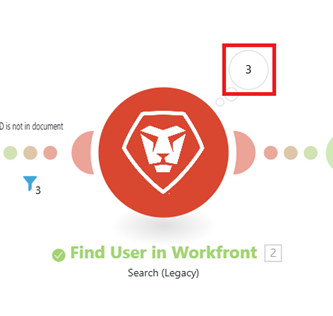

# Use Run once to test a scenario

When creating, updating, or refining a scenario, you can use the "Run once" button to trigger the scenario on demand. This way, you can test the scenario without waiting for its trigger logic, such as specific events or polling intervals.

You can also run a scenario once to configure data structures

>[!TIP]
>
>We recommend testing frequently as you create and refine scenarios.

## Use Run once functionality

The Run once feature is found in the scenario editor.

1. Click the **[!UICONTROL Scenarios]** tab in the left panel.
1. Select the scenario where you want to run the Scenario Scoring Expert.
1. Click anywhere on the scenario to enter the Scenario editor.
1. Click **Run once** at the lower-left corner of th Scenario editor.
1. (Conditional) If the scenario is triggered by a webhook or is a child scenario, select the input for the test run.

   * **Wait for an external webhook call**: The scenario will start listening for an incoming webhook call. You must trigger the webhook from the external system to provide the webhook. 

      For example, if the webhook is listening for a new request in Workfront, you must create a new request in Workfront to trigger it to complete the "Run once" functionality.

      >[!NOTE]
      >
      >This option is available for webhook scenarios only.

   * **Use a previous execution input**: You must select a previous execution. The "Run once" execution uses the input data that triggered the selected execution.

      To select a previous execution, select the execution and click **Run**.

      To examine the input data from the execution before selecting it, click **Preview input** for that execution.

      >[!NOTE]
      >
      >The scenario must have completed previous executions before this option is available.
   
   * **Provide input manually**: You must provide the webhook payload for the scenario input. This must be in JSON format.

      To provide the input, enter the text into the **Webhook payload** box and click **Run**.

## Examine the scenario output

You can examine the scenario output to see whether the scenario behaved as expected.

1. To view output from a module, click the output details bubble near the module. The number in the bubble represents the number of bundles that the module output.

   To view specific bundles in the module output, you can use the output panel's search bar, or filter for bundles with a specific status (such as Success, Warning, or Failed.)

   

1. To view the bundles that passed through a filter, click the filter. The number near the filter represents the number of bundles that passed through the filter.

   To view specific bundles handled by the filter, you can use the filter's search bar, or filter for bundles with a specific status (such as Passed or Failed.)
1. To search for a specific module or event in the execution panel, enter the search term into the **Search execution events** box. Results appear as you type.
1. To limit execution panel search results by status such as Success or Warning, click the **Status Filter** dropdown and select the status.
