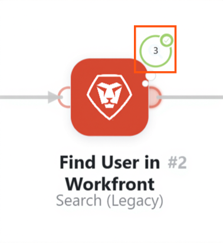

# View a specific scenario execution

You can view details of a specific scenario execution, including filtering and searching for scenario events.

## Access requirements

+++ Expand to view access requirements for the functionality in this article.

<table style="table-layout:auto">
 <col> 
 <col> 
 <tbody> 
  <tr> 
   <td role="rowheader">Adobe Workfront package</td> 
   <td> 
Any Adobe Workfront Workflow package and any Adobe Workfront Automation and Integration package

Workfront Ultimate

Workfront Prime and Select packages, with an additional purchase of Workfront Fusion.
 </td> 
  </tr> 
  <tr data-mc-conditions=""> 
   <td role="rowheader">Adobe Workfront licenses</td> 
   <td> 
Standard

Work or higher
 </td> 
  </tr> 
  <tr> 
   <td role="rowheader">Product</td> 
   <td>
   
If your organization has a Select or Prime Workfront package that does not include Workfront Automation and Integration, your organization must purchase Adobe Workfront Fusion.</li></ul>
   </td> 
  </tr>
 </tbody> 
</table>

For more detail about the information in this table, see [Access requirements in documentation](/help/workfront-fusion/references/licenses-and-roles/access-level-requirements-in-documentation.md).

+++

## View a specific execution

You can view an execution from the scenario's scenario history.

1. Click the **[!UICONTROL Scenarios]** tab in the left panel, then click the scenario.

   Or

   If you are working on the scenario in the Scenario editor, click the left arrow  near the upper-left corner of the window.

1. Click **History** near the name of the scenario.
    

1. Locate the execution you want to view, and click **Details** in the far right on the line for that execution. The [!UICONTROL details] link is visible only if the execution has details available.

   The scenario diagram opens, with the execution details panel open on the right.

   Modules that produced output for this execution are marked with green titles.

   Modules that did not run are dimmed.

1. To view output from a module, click the output details bubble near the module. The number in the bubble represents the number of bundles that the module output.

   

1. To view the bundles that passed through a filter, click the filter. The number near the filter represents the number of bundles that passed through the filter.
1. To search for a specific module or event in the execution panel, enter the search term into the **Search execution events** box. Results appear as you type.
1. To limit execution panel search results by status such as Success or Warning, click the **Status Filter** dropdown and select the status.

>[!NOTE]
>
>To create a link to a specific module, add `?moduleId=<module-id>` to the URL when viewing the following pages:
>
>* Scenario edit page (URL ends in `/edit`)
>* A specific scenario execution (URL ends in `/logs/<log-id>`)
>
>`<module-id>` refers to the number next to the module label when viewing the scenario.
>
>This can be useful when debugging scenarios or copying module configuration.

## Review an execution in the new scenario editor

In the new experience, when you open an execution from the execution history, the controls near the right side of the canvas help you find what went wrong without editing the scenario:

| Control | Details |
| ---------- | ---------- |
| Go to next error or warning | Shows how many modules had a problem in the current cycle. Each click moves to the next one, errors first and then warnings, from left to right. It centers the module and opens the first failed operation. The button is hidden when the execution had no errors or warnings. |
| Search modules | Find a module by name and center it on the canvas. Press Ctrl+K (Windows) or Command+K (Mac). |
| Notes | Show or hide the scenario's notes. This control displays only when the scenario has notes, and the notes are read-only here. |
| Explain flow | Animate the order in which the scenario's modules run. Click it again, or press Esc, to stop. |
| Zoom in, Zoom out, Focus, and minimap | Work the same way as in edit mode. |

The **Compact view** switch is also available in the upper-right corner. When you review an execution, it changes the layout only while you look at that execution. It does not change your Compact view setting for editing, and nothing is saved to the scenario.

Select an event in the execution to center and highlight the matching module. When operation details are available, the request and response panel opens. If the panel has no data, request and response details were not kept for that run. To collect them for future runs, see [Temporary debug logs](/help/workfront-fusion/create-scenarios/config-scenarios-settings/configure-scenario-settings.md#temporary-debug-logs).
